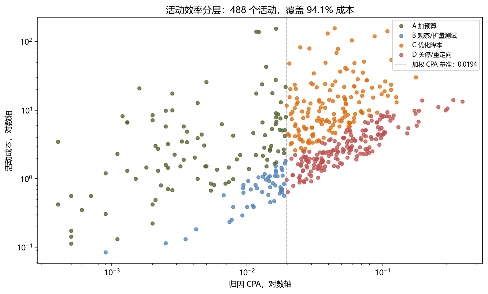

# Criteo 广告归因与预算效率分析


- [完整业务报告 PDF](reports/criteo_attribution_report.pdf)
- [业务分析 Notebook](01_business_analysis.ipynb)
- [归因决策 Notebook](02_attribution_decision.ipynb)
- [BI 数据导出 Notebook](03_export_bi_tables.ipynb)
- [全部可视化图表](reports/figures)

基于 Criteo Attribution Modeling 公开数据集的多触点归因与预算效率分析。项目使用 DuckDB 和 SQL 完成主要聚合，通过 Pandas、SciPy 和 Matplotlib 生成结果、敏感性分析与图表。

核心业务问题：

> 广告预算是否流向了真正影响转化的活动和广告触点？

完整业务报告见 [reports/criteo_attribution_report.pdf](reports/criteo_attribution_report.pdf)。

## 核心结论

| 结论 | 关键证据 |
|---|---|
| 点击到转化是最大流失 | 5,141,367 个点击未转化，占全部点击 86.44% |
| 活动效率差异显著 | 高效组 155 个活动 CPA 0.0063，低效组 333 个活动 CPA 0.0466，相差 7.4 倍 |
| 中间点击成本与信用错配 | 占完整路径成本 37.50%，三模型平均信用 5.01%，相对出价系数 0.134 |
| 绝对 CPA 不可用于外部对标 | IPW 情景下加权 CPA 从 4.3085 变化到 0.0204，浮动约 211 倍 |
| 活动相对排序较稳定 | CTR 排名相关为 1.0000，CPA 排名相关不低于 0.9687 |
| 高频曝光边际效率下降 | 每千曝光转化事件在 16 至 30 次后走平，单次转化成本继续上升 |
| 7 天窗口适合观察 | 覆盖 79.1% 完整路径事件和 75.2% 完整路径成本，但边际 CPA 不是最低 |

以上是描述性与敏感性分析结论，不是因果提升承诺。正式调整预算或出价前，需要小流量 A/B 测试或随机 holdout。

## 数据概况

| 指标 | 数值 |
|---|---:|
| 原始曝光日志 | 16,468,027 行 |
| 原始文件大小 | 约 2.59GB |
| 用户数 | 6,142,256 |
| 广告活动数 | 675 |
| 时间范围 | day 0 至 day 30，共 31 个自然日，末日存在截断 |
| 点击行数 | 5,947,563 |
| 样本点击率 | 36.12% |
| 转化行数 | 806,196 |
| 转化事件数 | 438,730 |
| 官方归因事件数 | 237,157 |
| 全站成本 | 4,829.34，匿名化成本口径 |
| 完整路径事件 | 362,504，占转化事件 82.63% |
| 完整路径触点 | 600,145 |

原始数据预期路径：

```text
data/raw/criteo_attribution_dataset.tsv
```


一行原始数据代表一次广告曝光，同一行可以同时包含点击、转化和官方归因标记。分析中的关键粒度是：

- 转化事件：按 `(uid, conversion_id)` 唯一确定。
- 路径触点：一次转化路径中的一次点击。
- 完整路径：路径行数等于 `click_nb`，且首次与末次点击均可验证。

`-1` 表示当前字段对该行不适用，不是普通缺失值。`attribution` 是事件级官方归因标记，不是触点信用。

## 分析结构

```text
01_business_analysis.ipynb
    原始数据读取、漏斗、每日趋势、活动效率、路径覆盖

02_attribution_decision.ipynb
    四种归因模型、成本信用错配、IPW、频次和归因窗口

03_export_bi_tables.ipynb
    BI 汇总数据导出
```

三个 Notebook 共用持久化数据库：

```text
data/criteo_analysis.duckdb
```

DuckDB 同一时间只允许一个写入连接。按顺序完整运行 Notebook 后，连接会在各 Notebook 末尾关闭。若手动跳过末尾单元，继续下一个 Notebook 前需要执行：

```python
con.close()
```

## 快速开始

推荐环境为 Python 3.13 或 3.14。当前依赖已在 Python 3.14.2 下验证，Notebook 原有执行元数据为 Python 3.13.9。安装依赖：

```bash
python -m pip install -r requirements.txt
```

从项目根目录依次运行：

```text
01_business_analysis.ipynb
02_attribution_decision.ipynb
03_export_bi_tables.ipynb
```

首次运行会扫描约 2.59GB 原始 TSV，后续查询直接使用 DuckDB 中的汇总结果。当前依赖版本记录在 `requirements.txt` 中。

图表中的中文字体在 `01_business_analysis.ipynb` 和 `02_attribution_decision.ipynb` 开头配置。非 Windows 环境运行时，需要改用本机已有的中文字体。

## 目录结构

```text
.
├── README.md
├── requirements.txt
├── 01_business_analysis.ipynb
├── 02_attribution_decision.ipynb
├── 03_export_bi_tables.ipynb
└── reports
    ├── criteo_attribution_report.pdf
    ├── figures
    │   ├── 01_funnel.png
    │   ├── 02_daily_trend.png
    │   ├── 03_campaign_efficiency.png
    │   ├── 04_path_length.png
    │   ├── 05_position_credit.png
    │   ├── 06_ipw_robustness.png
    │   ├── 07_frequency.png
    │   ├── 08_window_tradeoff.png
    └── tableau
        └── 17 张 BI 汇总数据表
```


## 主要数据表

| 表 | 粒度 | 用途 |
|---|---|---|
| `funnel_kpi` | 全站一行 | 漏斗与总体指标 |
| `daily_trend` | 每日一行 | 日期趋势 |
| `campaign_stats` | 活动一行 | 活动曝光、点击、成本与 CPA |
| `campaign_actions` | 活动一行 | A/B/C/D 动作分类 |
| `campaign_action_summary` | 动作一行 | 动作组汇总 |
| `conversion_events` | 转化事件一行 | 事件成本与路径完整性 |
| `conversion_path` | 路径触点一行 | 路径位置分析基础 |
| `attribution_credit` | 完整路径触点一行 | 四种模型信用 |
| `position_credit` | 位置一行 | 成本与信用对比 |
| `position_bid_multipliers` | 位置一行 | 相对出价信号 |
| `ipw_scenarios` | CTR 假设一行 | 绝对 CPA 敏感性 |
| `ipw_rank_stability` | CTR 假设一行 | 活动排名稳定性 |
| `frequency_buckets` | 频次区间一行 | 曝光频次与效率 |
| `attribution_window` | 窗口一行 | 覆盖率与边际 CPA |
| `official_window_rule` | 延迟区间一行 | 官方归因时效规则 |


## 归因模型

1. **Last-click**：真实末次点击获得全部信用。
2. **Linear**：路径内所有点击平均分配信用。
3. **Position 40/20/40**：首次和末次各获得 40%，中间点击合计获得 20%。
4. **Time-decay**：使用 7 天半衰期，越接近转化的点击权重越高。

每个转化事件的信用总和为 1。相对出价系数定义为：

```text
相对出价系数 = 三模型平均信用占比 / 成本占比
```

三模型为 Linear、Position 和 Time-decay；Last-click 仅作为基线。该系数只适用于完整路径内部，不是真实出价倍数。

## 输出产物

| 路径 | 内容 |
|---|---|
| `reports/criteo_attribution_report.pdf` | 完整业务报告 |
| `reports/figures/` | 8 张分析图表 |
| `reports/tableau/` | 17 张 BI 汇总数据表 |
| `data/criteo_analysis.duckdb` | 本地分析数据库，不纳入 Git 仓库 |

当前版本尚未包含可交互的 `.twb/.twbx` Tableau 看板。`reports/tableau/` 只提供看板数据源，不能替代交互式看板。

## 数据质量检查

项目在分析过程中保留并检查以下关键口径：

- 原始行数、点击行数、转化行数和归因事件数。
- `attribution = 1` 必须同时为点击。
- 转化事件按 `(uid, conversion_id)` 去重。
- `-1` 不参与路径位置和延迟计算。
- 每个完整路径事件的四种模型信用总和为 1。
- 位置成本占比与信用占比分别汇总为 100%。
- 488 个动作活动覆盖全部活动成本的 94.1%。

## 使用边界

1. 数据集是研究型构造样本，CTR 与绝对 CPA 不能代表真实行业水平。
2. 规则型归因不是因果提升估计，IPW 分析是敏感性压力测试。
3. 位置结论只覆盖完整路径，完整路径成本仅占全站成本 12.0%。
4. 频次与转化存在内生关系，不能直接解释为增加曝光的因果收益。
5. 活动 CPA 差异和 7.4 倍差距不能直接转化为预算迁移后的收益承诺。
6. 所有预算和出价动作都需要实验设计、护栏指标和上线后复盘。

## 数据来源

数据来源为 Criteo Attribution Modeling 公开数据集。使用、展示或对外发布前，应同时遵守数据发布方的最新许可和使用条款。
